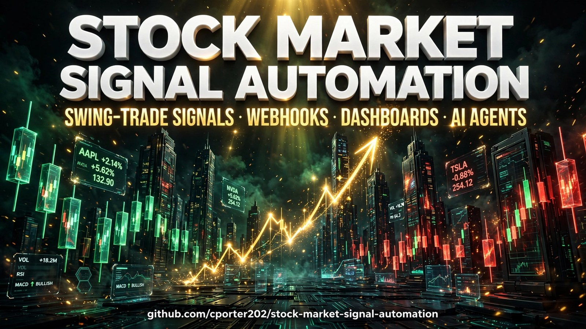
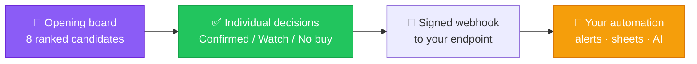

<div align="center">



<br />

# 📈 Stock Market Signal Automation


**Eight ranked candidates. Clear decisions. A plan for every confirmation.**

[](https://github.com/cporter202/stock-market-signal-automation/stargazers)
[](#-documentation-index)
[](#-consumer-examples)
[](LICENSE)

<p>
  <a href="https://kamdenai.com"><strong>🚀 Explore KamdenAI Membership</strong></a> ·
  <a href="#-start-here"><strong>📖 Start Here</strong></a> ·
  <a href="docs/getting-started.md"><strong>🔌 Build an Integration</strong></a>
</p>

</div>

## 📖 What this repo is

The public automation guide for **KamdenAI** — a stock signal membership that brings opening stock rankings, published signal plans, recorded morning outcomes, and a member workspace into one focused routine.

This repo explains the member experience and gives you consumer-side webhook examples: receive signal events, verify them, and route them into your own dashboards, alerts, sheets, and AI agents. All examples use fictional symbols and illustrative prices. The signal engine, selection formulas, weights, thresholds, and production infrastructure remain private.



## ⚡ The signal workflow

| Stage | What it means |
|---|---|
| 🌅 Before the open | Research and preparation provide context. Not official signals. |
| ✅ After opening review | Up to eight ranked candidates receive individual decisions — zero to eight may be Confirmed, each with a published entry, stop, and target. |
| 📊 Morning results | Recorded outcomes follow the 10:05 AM Eastern reference policy for remaining positions. |
| 🔬 Separate 3 PM study | Hypothetical holding comparisons for review. Excluded from official morning returns. |

**Status comes before rank.** Eight candidates does not mean eight trades. Rank one can be Watch only while ranks two and five are Confirmed. No confirmed signals is a valid session outcome.

| Member label | Meaning |
|---|---|
| ✅ Confirmed | Official signal for that session, with entry, stop, and target |
| 👀 Watch only | Observation and study; not an official entry |
| 🚫 No buy | Completed review did not qualify; later price movement doesn't rewrite it |
| ❓ Ungraded | Evidence incomplete; no official entry or return assigned |

> ⚠️ Confirmed is an official signal, not a broker fill. KamdenAI does not place broker orders — members control their own execution, position size, and exposure. **A signal can lose money, and several confirmed names can lose together.**

## 🖥️ Your member workspace

- **Feed → Signals** — opening rankings, individual decisions, published plans, daily results
- **Signal Results** — recorded outcomes, including losses, no fills, and unavailable evidence
- **Journal** — your own broker fills, shares, exits, and notes
- **Stock News + community** — context and discussion (member posts don't create confirmations)
- **Developer webhooks** — route selected events into your own tools

## 🔌 Build around the published record

```text
KamdenAI published event
  → signed webhook
    → your verified HTTPS receiver
      → private alerts / Sheets / dashboard / journal / AI summary
```

| Event | Purpose |
|---|---|
| `research_watchlist.created` | Research context (~9:15 AM ET); preparation only |
| `morning_scan.created` | Pre-open prep (~9:28 AM ET); not confirmation |
| `confirmed_buys.created` | Official confirmed signals after opening review |
| `quick_exit_results.created` | Recorded morning outcomes, 10:05 reference policy |

These are reference stages, not delivery guarantees. Use the actual publication timestamp, session date, and completion indicators. Test events verify delivery, not the trading system.

## 📚 Documentation index

**Understand the system**
- [Signal System Guide](docs/signal-system.md) — statuses, sessions, and how to read the board
- [Historical Results](docs/historical-results.md) — how recorded outcomes work
- [Architecture](docs/architecture.md) — how the pieces fit together

**Build integrations**
- [Getting Started](docs/getting-started.md) — the basic webhook flow
- [Webhook Events](docs/webhook-events.md) — every event type
- [Payload Field Reference](docs/payload-field-reference.md) — every field, explained
- [Security & Signing](docs/security-and-signing.md) — verify every delivery
- [Automation Recipes](docs/automation-recipes.md) — ready-made workflows
- [Make.com](docs/make-com.md) · [Google Sheets](docs/google-sheets.md) · [Discord](docs/discord.md) — platform guides
- [Broker Automation](docs/broker-automation.md) — your broker workflow stays yours
- [AI Agents](docs/ai-agents.md) — summarize without inventing confirmations

**Operate safely**
- [Launch Checklist](docs/launch-checklist.md) · [Troubleshooting](docs/troubleshooting.md)
- [DISCLAIMER.md](DISCLAIMER.md) — read this. Not financial advice.

## 🛠️ Consumer examples

| Example | What it does |
|---|---|
| [Node receiver](examples/node-webhook-receiver/README.md) | Receive and verify signed deliveries |
| [Python receiver](examples/python-webhook-receiver/README.md) | Flask receiver example |
| [Discord formatter](examples/discord-formatter/README.md) | Format event rows as alerts |
| [AI prompt builder](examples/ai-agent-prompt-builder/README.md) | Summarize without inventing confirmations or fills |
| [Risk sizing calculator](examples/risk-sizing-calculator/README.md) | Generic sizing arithmetic, not an account recommendation |
| [Simple dashboard](examples/simple-dashboard/README.md) | Preview fictional payloads locally |
| [Sheets logger](examples/google-sheets-logger/README.md) | Plan your event journal |
| [CSV templates](examples/csv-templates/signals-log.csv) | Signal log starter template |

Sample payloads: [multiple confirmations, incomplete decisions, no-confirmation events, modeled wins and losses](examples/payloads) — shortened teaching examples with fictional symbols.

> Alerts and integrations do not establish broker execution. Any broker workflow is your own separate integration — start with paper trading and human review. Historical and modeled returns do not guarantee future performance.

## 🚀 Start here

1. 📖 Read the [Signal System Guide](docs/signal-system.md)
2. 🔌 Follow [Getting Started](docs/getting-started.md) and [Webhook Events](docs/webhook-events.md)
3. 🔐 Review [Payload Fields](docs/payload-field-reference.md), [Security & Signing](docs/security-and-signing.md), [Architecture](docs/architecture.md)
4. ⚙️ Choose an [Automation Recipe](docs/automation-recipes.md)
5. 📊 Read [Historical Results](docs/historical-results.md) and the [Disclaimer](DISCLAIMER.md)
6. 💎 **[Explore KamdenAI membership →](https://kamdenai.com)**

## 🤝 Contributing

Member-facing explanations and consumer tooling only. Never include private source code, strategy research, selection rules, thresholds, credentials, signing secrets, infrastructure configuration, or paid member records. See [CONTRIBUTING.md](CONTRIBUTING.md) and [SECURITY.md](SECURITY.md).

MIT applies to this repository's public materials — see [LICENSE](LICENSE). It does not grant access to KamdenAI's private engine or member data.

## ⚠️ Disclaimer

This repository is for educational and software-development purposes only. Nothing here is financial advice, investment advice, or a recommendation to buy, sell, hold, or trade any security. Trading involves substantial risk — you can lose money. Past performance and sample results do not guarantee future performance. Test everything in a paper trading environment before using real capital. Full text: [DISCLAIMER.md](DISCLAIMER.md).

<!-- AIWITHCHRIS-BANNER-START -->
<p align="center">
  <a href="https://aiwithchris.com" target="_blank" rel="noopener">
    
  </a>
</p>
<p align="center">
  <a href="https://aiwithchris.com"><strong>🚀 Join my AI Playbook — aiwithchris.com</strong></a><br>
  $10/month · 3,600+ prompts · agent workflows · repo breakdowns · money ideas
</p>
<!-- AIWITHCHRIS-BANNER-END -->

